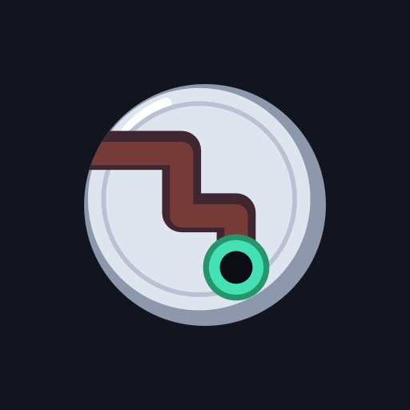
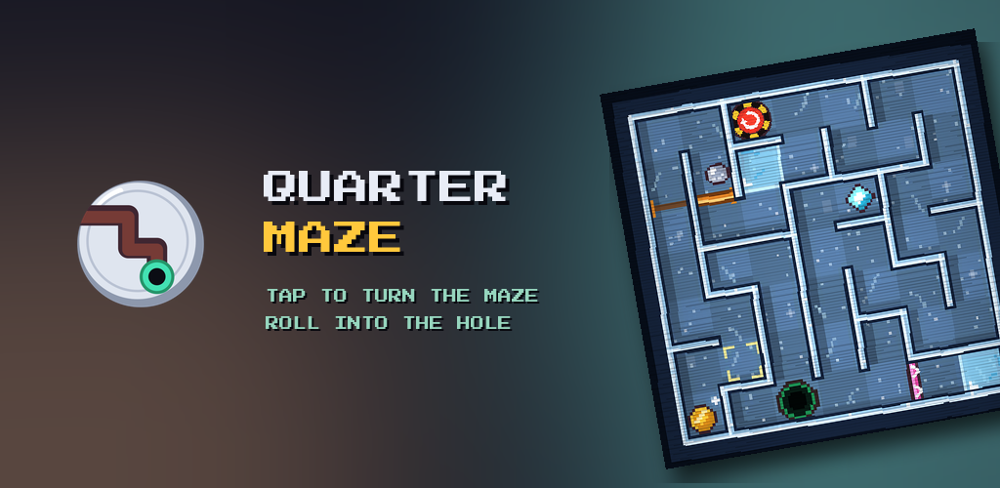
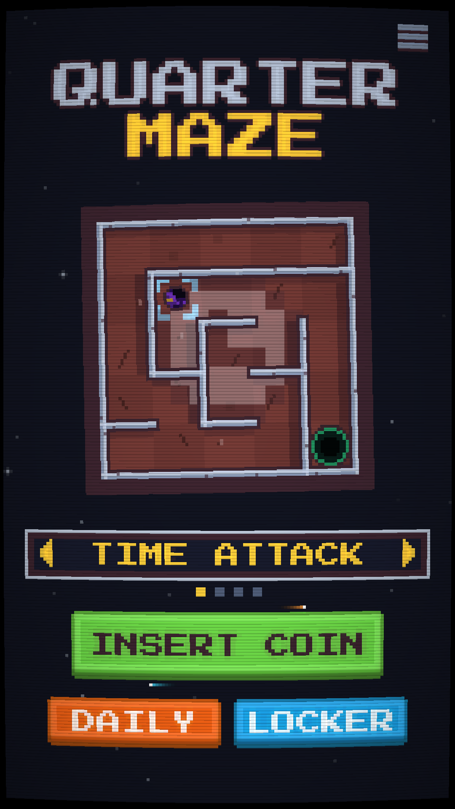
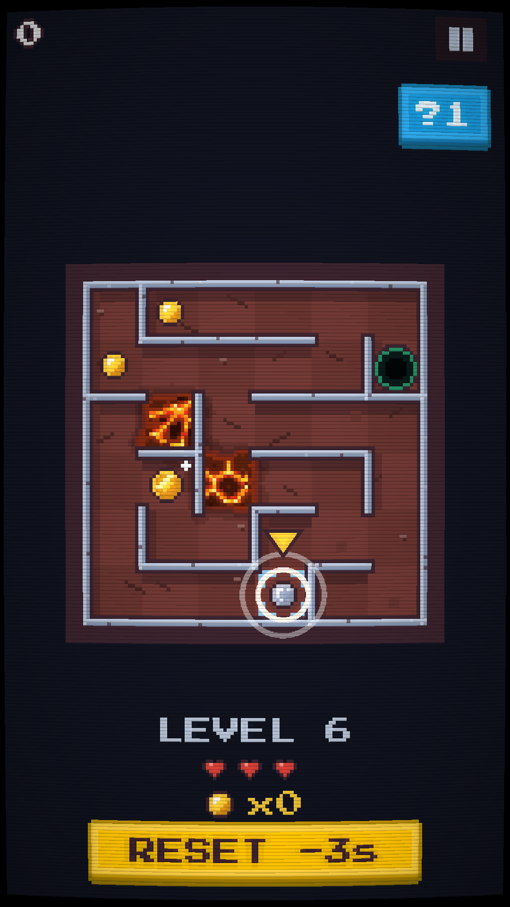
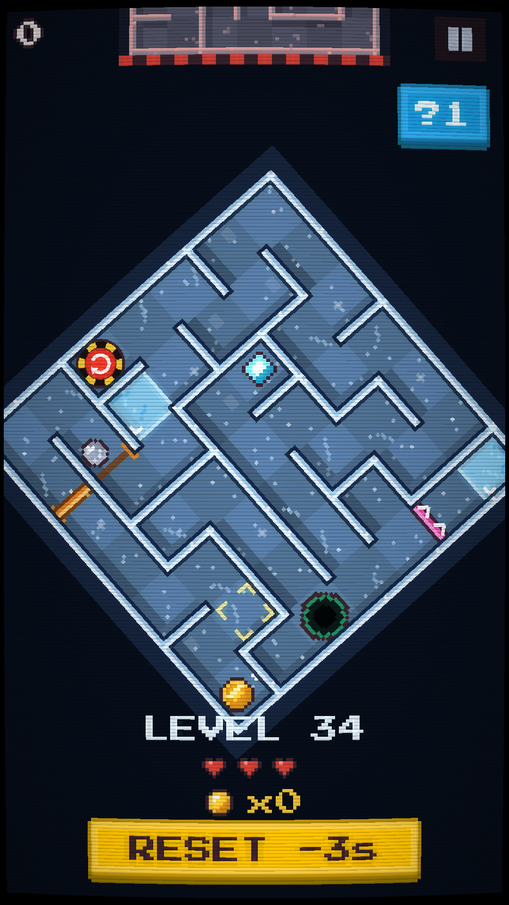
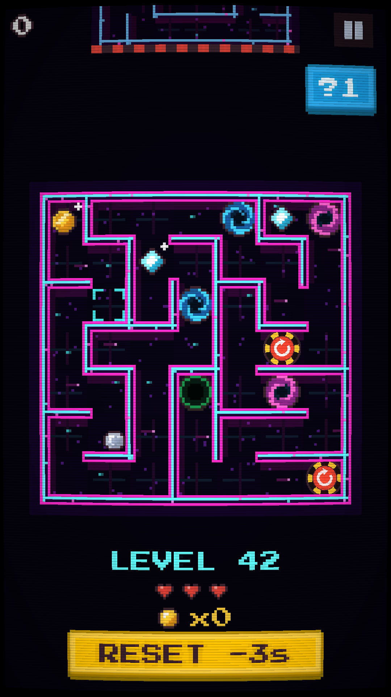

  

<h1 align="center">Quarter Maze</h1>

  <b>A pixel-art maze that turns a quarter at a time.</b> 
  Tap a side, the maze rotates, the ball falls. Reach the hole before the next maze arrives.

  <a href="https://play.google.com/store/apps/details?id=com.quartermaze.game">Google Play</a> ·
  <a href="https://quartermaze.github.io/">Website</a> ·
  <a href="https://quartermaze.github.io/privacy.html">Privacy Policy</a>

  

## The game

Every level is a small maze with a ball and a hole. You never move the ball: you tap the left or right side of the screen and the
whole maze turns a quarter, then gravity does the rest. Plan the turns, slide into the hole, and keep going before the next maze
comes down on you.

- **Six worlds**: dungeon, swamp, works, frost, neon and an 80s arcade, each with its own trick (lava, one-way doors, moving walls,
  ice, portals, enemy balls) and a boss every ten levels.
- **Five ways to play**: TIME ATTACK, STEP CHASE, PERK RUN (pick a power-up card after each level), TILT (roll the ball by tilting
  the phone) and a DAILY run with the same maze for everyone.
- **Endless**: after the sixth world the loop starts again, harder.
- Skins, upgrades, boss keys that open secret exits, global leaderboards with Google Play Games.

  
  
  
  

## This repository

This is the public website of the game, served by GitHub Pages at <https://quartermaze.github.io/>.

| File | What it is |
|---|---|
| `index.html` | The game's home page |
| `privacy.html` | The privacy policy (the link used on Google Play) |
| `app-ads.txt` | Authorized ad sellers ([IAB app-ads.txt](https://iabtechlab.com/ads-txt/)), read by AdMob |
| `assets/` | Icon, store graphic and screenshots |

The game itself is made with [Godot 4](https://godotengine.org/) and is not open source.

## Contact

quartermaze@gmail.com

© 2026 Zwenk. All rights reserved.
